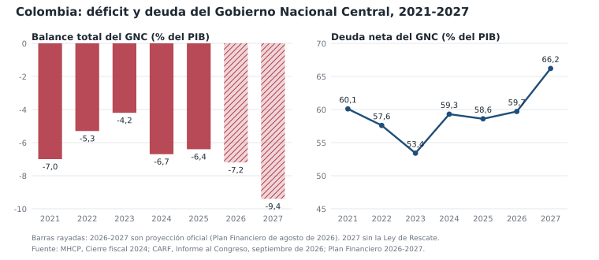
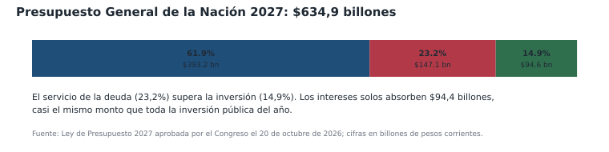
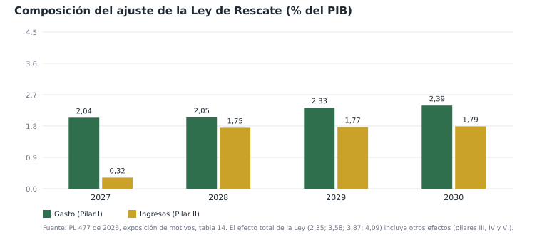

# Finanzas públicas de Colombia: deterioro 2022-2026 y contraste con la Ley de Rescate Económico

**Fecha de corte:** 2026-11-03<br>
**Periodo analizado:** 2022-2027 (con proyecciones a 2030)<br>
**Cobertura principal:** Gobierno Nacional Central (GNC)<br>
**Autor:** Investigación económica, OpenChamber<br>
**Licencia:** Apache-2.0

> **Advertencia de estado:** el Proyecto de Ley 477 de 2026 (Cámara), conocido como
> “Ley de Rescate Económico”, fue radicado el 2026-10-29 y **no es ley**. Al cierre de
> este informe se encuentra en publicación y reparto para primer debate. Todas las
> cifras asociadas a sus efectos son estimaciones oficiales o de analistas, no
> resultados observados.

---

## Resumen ejecutivo

1. **El deterioro fiscal es real y estructural.** El déficit del GNC pasó de 5,3% del PIB
   en 2022 a 6,7% en 2024, 6,4% en 2025 y una proyección oficial de 7,2% en 2026
   (7,8% según el CARF). Para 2027, sin medidas, el Gobierno proyecta 9,4% del PIB
   (9,5% el CARF), el mayor déficit de la historia reciente. La deuda neta ronda 60%
   del PIB y llegaría a 66,2%-67,4% en 2027, cerca del límite de 71% de la regla fiscal (MHCP, 2026a; CARF, 2026a).

2. **La consolidación de 2023 fue cíclica, no estructural.** El déficit bajó a 4,2% del PIB
   y la deuda neta a 53,4% gracias a ingresos tributarios excepcionales (petróleo caro,
   inflación alta y la reforma de 2022). Cuando esos ingresos se normalizaron, el
   déficit volvió a 6,7% en 2024. El balance primario —el indicador que de verdad
   mide el esfuerzo— sigue siendo deficitario en todos los años del periodo: -1,0% en
   2022, -0,3% en 2023, -2,4% en 2024, -3,5% en 2025 y -3,3% en 2026 (MHCP, 2024; CARF, 2026a).

3. **El problema inmediato es el peso de los intereses y la rigidez del gasto.** Los
   intereses pasaron de 3,9% del PIB en 2023 a 4,4% en 2024; en 2025 bajaron
   temporalmente a 2,8% por operaciones de manejo de deuda, y se proyectan en 4,9%
   del PIB en 2027 ($104,7 billones), equivalentes a cerca de un tercio del recaudo
   tributario. El presupuesto de 2027 destina $147,1 billones al servicio de la deuda
   (23,2% del total), más que los $94,6 billones de inversión. El gasto de
   funcionamiento absorbe 62% del presupuesto (MHCP, 2026a; Congreso de la República, 2026).

4. **La Ley de Rescate es cuantitativamente relevante, pero está mal secuenciada.**
   El proyecto busca un ajuste de 2,2%-2,4% del PIB en 2027 y de 4,1%-4,7% hacia 2030.
   Sin embargo, en 2027 el 87% del efecto proviene de recorte de gasto (2,04% del PIB)
   y solo 0,32% de ingresos; los impuestos nuevos (IVA, renta personal, salud) llegan
   en 2028. Es decir, el año crítico depende casi por completo de la parte más difícil
   de ejecutar: recortar gasto corriente en una coalición dividida y con el CARF
   estimando que solo una fracción del recorte es factible (MHCP, 2026b; CARF, 2026a).

5. **La reforma es un cambio de carga, no solo un ajuste.** Baja la renta corporativa de
   35% a 33% en 2027 y a 31% en 2028, suaviza el impuesto al patrimonio (umbral de
   95.500 UVT, tarifas de 0,5% y 1,0%, vigencia hasta 2030) y amplía el IVA a bienes
   de consumo cotidiano (café, azúcar, pastas, chocolate, frutas, verduras, internet de
   estratos 1-3, computadores y celulares de gama baja) desde 2028. Para compensar,
   crea EfectIVA, una devolución monetaria del IVA para cerca de 35 millones de
   personas. La progresividad depende de que esa devolución funcione: si llega, los
   microsimulacros independientes encuentran ganancias para el 30% más pobre; si no
   llega, el efecto se concentra en la clase media formal y en el consumo (MHCP, 2026b; La República, 2026c).

6. **El ajuste estabiliza la deuda, no la reduce.** El escenario oficial con la Ley
   mantiene la deuda neta alrededor de 64,2% del PIB hasta 2030, por encima del ancla
   de 55% y a 7 puntos del límite de 71%. El propio Ministerio de Hacienda reconoce
   que el paquete “apenas” alcanza para estabilizar la deuda; reducirla exigiría más
   crecimiento o ajustes adicionales. No es un “rescate” que devuelva la deuda a niveles
   prudentes: es el primer tramo de una consolidación de varios años (MHCP, 2026b; CARF, 2026a).

7. **El riesgo principal es político y de credibilidad, no de diagnóstico.** El Gobierno
   tiene mayoría en las comisiones económicas (63 de 90 integrantes, 70%), pero no
   votos comprometidos: el Centro Democrático y sectores de la coalición rechazan los
   aumentos de IVA y de aportes a salud a la clase media. La legislatura termina el
   2026-12-16 y el trámite requiere cuatro debates. Si se diluye el capítulo tributario
   y falla la ejecución del gasto, el déficit de 2027 se quedará entre 8% y 9%, y el
   ajuste lo impondrá el mercado, con peores consecuencias distributivas (Orza, 2026; El Espectador, 2026a).

8. **Hay pasivos no financiados que el proyecto no resuelve.** El terremoto del
   2026-08-10 dejó daños estimados en $30 billones y un costo de reconstrucción
   revisado a $54 billones (2,6% del PIB), además de un decreto de emergencia que
   la Corte Constitucional aún debe revisar. La deuda del sistema de salud con
   prestadores ronda $27,8 billones (60,5% en mora) y el faltante actuarial de la UPC
   se estima en $33,4 billones. Son presiones ciertas sobre el mismo presupuesto que
   la Ley pretende ordenar (Presidencia de la República de Colombia, 2026; Infobae, 2026; Portafolio, 2025).

**Abreviaturas:** MHCP = Ministerio de Hacienda y Crédito Público; CARF = Comité
Autónomo de la Regla Fiscal; DANE = Departamento Administrativo Nacional de Estadística;
BanRep = Banco de la República; FMI = Fondo Monetario Internacional; GNC = Gobierno
Nacional Central; BPNE = Balance Primario Neto Estructural.

---

## 1. Contexto y pregunta

Colombia llega a 2026 con una paradoja. La economía crece —3,4% anual en el segundo
trimestre de 2026, 2,6% en 2025—, el desempleo está en 8,0% (septiembre de 2026) y la
pobreza monetaria bajó a 28,0% en 2025, el nivel más bajo de la serie. Pero el Estado
central gasta sistemáticamente más de lo que recauda, la deuda pública es la más cara
de la historia reciente y el pago de intereses compite con la inversión y con el gasto
social. Esa combinación —crecimiento moderado, mercado laboral relativamente sano y
déficit fiscal récord— es la que explica por qué el nuevo Gobierno, posesionado el
2026-08-07, convirtió el ajuste fiscal en su primera prioridad legislativa (DANE, 2026a, 2026d; BanRep, 2026).

La pregunta de este informe es doble:

1. ¿Cómo evolucionaron las finanzas del Estado colombiano entre 2022 y 2026, y cuál es
   su estado actual?
2. ¿La “Ley de Rescate Económico” propuesta por el presidente Abelardo de la Espriella
   es una respuesta suficiente, creíble y equitativa a ese estado de cosas?

El análisis se concentra en el Gobierno Nacional Central (GNC), que es la unidad
relevante para la regla fiscal y para el déficit que se discute en el Congreso. Cuando
se usan datos del Gobierno General o del sector público no financiero, se indica
explícitamente.

---

## 2. Datos y metodología

### 2.1 Fuentes y jerarquía

Se priorizaron fuentes primarias:

- **Ministerio de Hacienda y Crédito Público (MHCP):** Cierre Fiscal GNC 2024,
  actualización del Plan Financiero 2026-2027 (2026-08-27), exposición de motivos y
  articulado del Proyecto de Ley 477 de 2026.
- **Comité Autónomo de la Regla Fiscal (CARF):** Informe al Congreso de septiembre
  de 2026, Seguimiento Fiscal de septiembre de 2026 y concepto técnico sobre el MFMP
  2026.
- **DANE:** cuentas nacionales (PIB IV trimestre de 2025 y II trimestre de 2026), IPC
  (diciembre de 2025 y septiembre de 2026), GEIH (septiembre de 2026) y pobreza
  monetaria 2025.
- **Banco de la República:** Informe de la Junta Directiva al Congreso, octubre de
  2026.
- **Congreso de la República:** ficha y texto del Proyecto 477 de 2026; Ley de
  Presupuesto 2027.
- **Corte Constitucional:** Sentencia C-075 de 2026.
- **FMI:** Consulta del Artículo IV de 2025 y declaraciones de la misión de 2026.
- **Calificadoras:** Fitch, S&P Global Ratings y Moody's.
- **Secundarias:** prensa económica (La República, Portafolio, El Tiempo, Reuters,
  AP, Bloomberg Línea, El Colombiano) y centros de pensamiento (Fedesarrollo, ANIF,
  Observatorio Fiscal Javeriana). Se usan para reacciones, no para sustituir el dato
  primario.

### 2.2 Definiciones

- **Balance total del GNC:** ingresos totales menos gastos totales, incluidos intereses.
- **Balance primario:** excluye el pago de intereses. Es el indicador del esfuerzo
  fiscal discrecional.
- **Deuda neta:** deuda bruta menos activos financieros de la Nación. Es el indicador
  de la regla fiscal.
- **BPNE:** Balance Primario Neto Estructural, ajustado por ciclo económico, ciclo
  petrolero y términos de intercambio.
- **Billones:** se usa la convención colombiana, 1 billón = 10^12 pesos.
- **PIB nominal:** alrededor de $1.930 billones a mediados de 2026 (suma de cuatro
  trimestres), según el DANE y el CARF.

### 2.3 Advertencias

- Las series fiscales se revisan. El PIB de 2023 se revisó de 0,6% a 0,8% y el de 2024
  de 1,7% a 1,5% en la última actualización del DANE; las ratios sobre PIB cambian con
  esas revisiones. No se empalman series sin nota.
- El déficit de 2025 y las proyecciones de 2026-2027 incorporan **operaciones de manejo
  de deuda (OMD)** que reducen los intereses causados. La comparación con años
  anteriores no es homogénea; se advierte en cada caso.
- Las cifras de 2026 y 2027 son proyecciones. El déficit de 2026 aún no se observa:
  a agosto el acumulado era 4,6% del PIB ($91,2 billones), y el Gobierno proyecta
  7,2% para el cierre.
- El proyecto de ley puede cambiar en el Congreso. Los efectos fiscales que se citan
  son los de la exposición de motivos, no una estimación independiente del articulado
  final.
- Las cifras en porcentaje del PIB se calculan con el PIB nominal de cada año. Las
  proyecciones oficiales y las del CARF se presentan por separado cuando difieren.
  Ninguna cifra debe citarse como observada si está marcada como proyección o
  estimación.

---

## 3. Resultados

Las citas del texto siguen el formato APA 7 (autor, año); las referencias completas, con enlaces, están en la sección 7.

### 3.1 El punto de partida: 2022

El Gobierno de Gustavo Petro recibió en agosto de 2022 una economía que crecía 7,3%
y un GNC que **cerró 2022** con un déficit de 5,3% del PIB, una deuda neta de 57,6% y un
balance primario de -1,0%. El año 2022 fue el último de un ciclo de ingresos excepcionales: el precio del
petróleo, la inflación y la actividad por encima del potencial inflaron la base tributaria.
La reforma tributaria de 2022 (Ley 2277) añadió ingresos permanentes, pero también
aumentó la dependencia de rentas cíclicas (MHCP, 2024; FMI, 2025).

Ese punto de partida importa porque desmiente dos relatos simétricos. No es cierto que
el Gobierno anterior haya recibido “cuentas sanas”: recibió un déficit de 5,3% y una
deuda 2,6 puntos por encima del ancla. Tampoco es cierto que todo el deterioro posterior
sea culpa de ese Gobierno: la deuda ya había dado un salto en 2020 (de 48,4% a 60,7%
del PIB) y el gasto rígido —salud, pensiones, transferencias— es una tendencia de una
década (MHCP, 2024; FMI, 2025).

### 3.2 La falsa consolidación de 2023

En 2023 el déficit bajó a 4,2% del PIB y la deuda neta a 53,4%. El Gobierno cumplió la
regla fiscal y presentó el resultado como prueba de disciplina. Pero el ajuste fue en gran
parte cíclico:

- Los ingresos totales subieron a 18,7% del PIB, 2,4 puntos más que en 2022, por
  recaudo tributario excepcional.
- El gasto primario se contuvo por subejecución de inversión y por el desfase entre
  apropiación y ejecución.
- El balance primario quedó en -0,3%, cerca del equilibrio, pero no en superávit (MHCP, 2024).

Fue una consolidación “de viento de cola”. Cuando el viento cambió, el déficit volvió a
subir. Esto no es un juicio ideológico: es lo que muestran las cuentas. El CARF y el
propio MHCP reconocen que 2023 fue un año de ingresos inusualmente altos (CARF, 2026a; MHCP, 2024).

### 3.3 2024-2025: el desplome de ingresos y la activación de la cláusula

Entre 2023 y 2024 los ingresos totales cayeron de 18,7% a 16,5% del PIB (-2,2 puntos),
mientras el gasto subió de 22,9% a 23,2%. El déficit saltó a 6,7% y la deuda neta a
59,3%, 5,9 puntos más en un año. La caída de ingresos fue el factor dominante: los
tributarios pasaron de 16,6% a 14,4% del PIB. Contribuyeron la desaceleración, la
apreciación del peso, los fallos judiciales sobre deducciones y la menor renta
petrolera (MHCP, 2024).

En 2025 el déficit se moderó a 6,4%, pero el balance primario empeoró a -3,5%. El
Gobierno activó la cláusula de escape de la regla fiscal en junio de 2025, con el argumento
de que cumplir la meta exigiría un ajuste incompatible con la estabilidad macroeconómica.
La cláusula suspendió la regla para 2025-2027. El costo de esa decisión fue una pérdida
de credibilidad que se reflejó en las calificadoras: Fitch bajó la nota a BB en diciembre
de 2025 y S&P a BB- en abril de 2026, el nivel más bajo de Colombia desde 1993 (Fitch, 2025; S&P Global Ratings, 2026).

El año 2025 también dejó dos presiones que explican el déficit actual: el Fondo de
Estabilización de Precios de los Combustibles (FEPC) y el sistema de salud. El primero
acumuló un déficit causado que se paga en 2026-2027; el segundo arrastra un faltante
de UPC y una deuda con prestadores que el Gobierno anterior no reconoció por completo.
El “sinceramiento” de 2026 consiste, en buena parte, en reconocer esas obligaciones (CARF, 2026a; FMI, 2025).

### 3.4 2026: el sinceramiento y el terremoto

El nuevo Gobierno llegó el 2026-08-07 y en tres semanas presentó una actualización del
Plan Financiero que cambió el diagnóstico:

- El déficit de 2026 pasó de 5,3% a 7,2% del PIB.
- El déficit primario pasó de -2,1% a -3,3%.
- El déficit de 2027 pasó de 4,5% a 9,4% del PIB.
- La deuda neta de 2026 pasó de 58,9% a 59,7%; la de 2027, a 66,2%.
- Las necesidades de financiamiento de 2027 se duplicaron, de $130,4 a $266,3 billones (MHCP, 2026a).

El Gobierno atribuye el cambio a dos factores: (i) $30,2 billones de ingresos
contingentes a una reforma tributaria que el Congreso no aprobó y (ii) $36 billones de
obligaciones de gasto omitidas o subestimadas (pensiones, salud, salarios, universidades,
FEPC y servicio de la deuda). El CARF acepta parte del diagnóstico, pero discrepa en la
magnitud del ajuste factible: estima que de los $21,7 billones de recorte de 2026 solo
se ejecutarán $9,7 billones (0,4% del PIB), por lo que el déficit cerraría en 7,8%, no en
7,2% (CARF, 2026a).

A esa presión se sumó el terremoto del 2026-08-10 (magnitud 7,4, epicentro en San José
del Palmar, Chocó). El sismo afectó 16 departamentos y 498 municipios, dejó 335
fallecidos y 4.516 heridos, y destruyó 51.778 viviendas. La estimación inicial de daños
fue $30 billones; en octubre el Gobierno la revisó a $54 billones (2,6% del PIB), de los
cuales $19 billones son vivienda. El Gobierno declaró la emergencia económica el
2026-08-20 y creó el Fondo Milagro. La Corte Constitucional aún debe revisar el decreto;
si lo tumba, como hizo con la emergencia de diciembre de 2025 (Sentencia C-075 de
2026), el financiamiento de la reconstrucción quedará aún más expuesto (Presidencia de la República de Colombia, 2026; El Colombiano, 2026; Corte Constitucional, 2026).

### 3.5 La situación hoy: indicadores clave

| Indicador | Último dato | Fuente / nota |
|---|---:|---|
| Déficit total GNC 2026 | 7,2% del PIB (oficial) / 7,8% (CARF) | MHCP, PF ago-2026; CARF sep-2026 |
| Déficit primario 2026 | -3,3% (oficial) / -3,9% (CARF) | Ibíd. |
| Deuda neta GNC 2026 | 59,7% (oficial) / 60,2% (CARF) | Ibíd. |
| Déficit total 2027 sin medidas | 9,4% (oficial) / 9,5% (CARF) | Ibíd. |
| Deuda neta 2027 | 66,2% (oficial) / 67,4% (CARF) | Ibíd. |
| Intereses 2027 | 4,9% del PIB ($104,7 billones) | PF ago-2026 |
| Necesidades de financiamiento 2027 | $266,3 billones | PF ago-2026 |
| Crecimiento PIB 2026 / 2027 | 2,5% / 1,8% | MHCP; CARF coincide en 2027 |
| Inflación anual (sep-2026) | 6,29% | DANE |
| Tasa de política (sep-2026) | 12,25% | BanRep |
| Desempleo (sep-2026) | 8,0% | DANE |
| Pobreza monetaria 2025 | 28,0% (extrema 9,6%) | DANE |



*Fuente: MHCP (2024, 2026a), CARF (2026a) y Banco de la República (2026).*

*Figura 1. Balance total y deuda neta del GNC. 2026-2027 son proyecciones oficiales sin
la Ley de Rescate. Fuente: MHCP, Cierre Fiscal 2024; CARF, Informe al Congreso,
septiembre de 2026; Plan Financiero 2026-2027.*

La lectura de la figura es directa: el déficit no se corrigió en el ciclo de altos ingresos
y volvió a deteriorarse cuando los ingresos se normalizaron. La deuda neta se estabilizó
alrededor de 58%-60% entre 2024 y 2026, pero a un costo: el déficit primario se mantuvo
entre 2,4% y 3,5% del PIB. Esa es la definición de un desequilibrio estructural: incluso
sin choques, el Estado gasta más de lo que recauda antes de pagar intereses.

El presupuesto de 2027 aprobado por el Congreso asciende a $634,9 billones. Su
composición explica por qué el ajuste es tan difícil: 62% es funcionamiento, 23% es
servicio de la deuda y solo 15% es inversión. Los intereses solos ($94,4 billones) casi
igualan toda la inversión pública del año (Congreso de la República, 2026).



*Figura 2. Composición del Presupuesto General de la Nación 2027. Fuente: Ley de
Presupuesto 2027, aprobada el 2026-10-20.*

### 3.6 La Ley de Rescate: qué propone exactamente

El Proyecto de Ley 477 de 2026, radicado en la Cámara el 2026-10-29, tiene 106 artículos
y seis pilares declarados: reducción del gasto, EfectIVA/IVA, crecimiento e inversión,
atracción de capitales, institucionalidad fiscal y lucha contra la evasión. Los contenidos
con impacto fiscal son (MHCP, 2026b):

**a) Gasto y organización del Estado (arts. 1-19).**
- Faculta al Gobierno para aplazar o reducir transferencias y gastos ordenados por ley
  que no tengan concepto favorable del CONFIS, desde 2027 y hasta 2030 (art. 2). Es
  la medida más potente y la más expuesta a demandas de inconstitucionalidad, porque
  permite al Ejecutivo desconocer mandatos legales de gasto.
- Crea un Programa de Eficiencia del Gasto y un estudio técnico sobre leyes que ordenan
  gasto y fondos especiales (arts. 4-5).
- Otorga facultades extraordinarias por seis meses para suprimir, fusionar o escindir
  ministerios, departamentos administrativos, superintendencias y otras entidades, y
  para modificar plantas de personal (art. 7).
- Reduce 20% nominal los gastos de personal en 2028 y 50% los contratos de prestación
  de servicios en 2027 (arts. 16-17).
- Autoriza la enajenación de activos del Estado (arts. 11-15).

**b) Ingresos y seguridad social (arts. 20-70).**
- Exonera de aportes patronales a SENA, ICBF y salud para salarios de hasta 2 SMLMV;
  cotización reducida entre 2 y 3 SMLMV; cotización plena por encima de 3 SMLMV.
- Aumenta la cotización a salud a cargo del empleado de 4% a 5,5%-8% según ingreso
  (desde 2 SMLMV), y a 12,5%-15,5% para independientes (art. 21).
- Redirige un punto de las cajas de compensación a salud (art. 22).
- Renta corporativa: 33% en 2027 y 31% desde 2028 (hoy 35%); sobretasa de 5 puntos
  para bancos y aseguradoras hasta 2030 (art. 57).
- Renta de personas naturales: baja el umbral de 1.090 a 720 UVT, reduce la renta exenta
  del 25% de 790 a 630 UVT y el tope de deducciones de 1.340 a 1.180 UVT (arts. 47-50).
- Impuesto al patrimonio: umbral de 95.500 UVT ($5.002 millones), tarifas de 0,5% y
  1,0%, vigencia 2027-2030 (arts. 66-68). Es una extensión con alivio frente al régimen
  actual, que expira en 2026.
- IVA: elimina la tarifa del 5% desde 2028; pasa al 19% café tostado, azúcar, pastas,
  chocolate, aceites, frutas y verduras frescas, internet de estratos 1-3, computadores
  y celulares de gama baja, boletas de cine, entre otros (arts. 42-46).
- EfectIVA: devolución monetaria del IVA por persona, desde 2028, con 100% para
  pobreza extrema y pobreza, y 50%, 40% o 30% para vulnerabilidad; tope de 5,5 UVT
  mensuales ($288.000 con la UVT de 2026) (arts. 38-40).
- Normalización tributaria 2027: 15% sobre activos omitidos y 5% sobre criptoactivos
  (arts. 70-71).
- Régimen RUGE para grandes inversiones: renta de 20% o 26%, estabilidad jurídica de
  16 años y umbrales de inversión de 2,58 a 8,14 millones de UVT (art. 69).

**c) Regla fiscal e institucionalidad (arts. 72-79).**
- Crea una “Cuenta de Control” de desviaciones del BPNE y un mecanismo de corrección
  automática si el saldo cae por debajo de -0,5% del PIB.
- Pone fin a la cláusula de escape en 2026 (la activación de junio de 2025 aplica solo a
  2025-2026) y deja que el Gobierno fije las metas de BPNE 2027-2030 por decreto, con
  insumo del CARF, a más tardar el 2027-03-31.
- Refuerza los límites de deuda (63% y 71% del PIB) con reglas de crecimiento del gasto.

**d) Facultades a la DIAN y alivios (arts. 82-104).**
- Facultades extraordinarias por seis meses para fortalecer la administración tributaria
  (art. 96), rebaja transitoria de sanciones e intereses, terminación por mutuo acuerdo
  y conciliación contencioso-administrativa.

### 3.7 El número central: ¿cuánto ajusta y de dónde sale?

La tabla 14 de la exposición de motivos es la única cuantificación oficial del paquete.
Sus cifras son (MHCP, 2026b, tabla 14):

| Componente | 2027 | 2028 | 2029 | 2030 |
|---|---:|---:|---:|---:|
| Reducción del Estado y seguridad social (Pilar I) | 2,04% | 2,05% | 2,33% | 2,39% |
| EfectIVA, IVA e ingresos (Pilar II) | 0,32% | 1,75% | 1,77% | 1,79% |
| Crecimiento, inversión y otros (Pilares III-IV-VI) | -0,01% | -0,22% | -0,23% | -0,09% |
| **Efecto total de la Ley** | **2,35%** | **3,58%** | **3,87%** | **4,09%** |
| Otras medidas de la estrategia | 0,05% | 0,71% | 0,72% | 0,64% |
| **Efecto total de la estrategia** | **2,39%** | **4,29%** | **4,59%** | **4,73%** |

*Fuente: PL 477 de 2026, exposición de motivos, tabla 14. Porcentajes del PIB.*

Tres lecturas son relevantes:

1. **El ajuste de 2027 es casi todo gasto.** 2,04 de 2,35 puntos (87%) son recorte de
   gasto; solo 0,32 puntos son ingresos. El Gobierno comunica que cerca del 70% del
   ajuste es gasto; la tabla 14 muestra 87% en 2027 y 57%-60% en 2028-2030. En 2027,
   el año que el mercado mira, la apuesta es casi exclusivamente de ejecución de
   recortes (MHCP, 2026b).

2. **Los impuestos llegan tarde.** El IVA y la renta personal empiezan en 2028; la
   EfectIVA también. Por eso el efecto de ingresos salta de 0,32% a 1,75% del PIB entre
   2027 y 2028. Si el Congreso aprueba el proyecto a finales de 2026, las medidas de
   renta podrían aplicar en 2027; si se demora, muchas solo regirían en 2028. El exministro
   Juan Camilo Restrepo advirtió que el calendario legislativo hace improbable que las
   medidas de renta rijan en 2027 (Portafolio, 2026d).

3. **El efecto permanente es menor que el ajuste inicial.** Hacia 2030 la Ley aporta
   4,09% del PIB; de ese total, 2,39 puntos son gasto y 1,79 ingresos, y el resto es un
   efecto neto negativo de -0,09 puntos. La deuda se estabiliza alrededor de 64,2% del
   PIB, no converge al ancla de 55%.



*Figura 3. Composición del efecto fiscal de la Ley de Rescate. Fuente: PL 477 de 2026,
tabla 14.*

### 3.8 ¿Es suficiente? La comparación con las metas independientes

| Referencia | Ajuste requerido | Horizonte | Comentario |
|---|---:|---|---|
| Gobierno (Ley) | 2,2%-2,4% del PIB | 2027 | 87% gasto en 2027 |
| CARF (estabilizar deuda) | 6,4% del PIB promedio | 2028-2030 | Requiere superávit primario de 2,1% en 2028 |
| FMI (Artículo IV 2025) | 3,2% del PIB | 2026-2028 | Mezcla equilibrada de ingresos y gastos |
| Fitch | ~3% del PIB | Mediano plazo | “Muy difícil” solo por gasto |
| Gobierno (escenario con Ley) | 4,7% del PIB | 2030 | Deuda estable en 64,2% |

*Fuente: MHCP (2026a, 2026b), CARF (2026a), FMI (2025) y Fitch (2025). El “ajuste requerido” del CARF es el cambio de balance
primario necesario para estabilizar la deuda, no el efecto de la Ley.*

La comparación no es manzanas con manzanas, y ahí está el problema. El Gobierno mide
el efecto de la Ley sobre el balance primario; el CARF mide el esfuerzo necesario para
que la deuda deje de crecer. Con las cifras oficiales, la **estrategia completa** (Ley más
otras medidas) mejora el balance primario en 4,29% del PIB hacia 2028; la Ley sola
aporta 3,58%. El CARF estima que se necesita un superávit primario de 2,1% en 2028,
mientras que el escenario oficial con la estrategia completa llega a cerca de -0,3% (la
Ley sola, a cerca de -0,9%). La diferencia es de aproximadamente 2,3 puntos del PIB.
Esa brecha es la razón por la cual la deuda se estabiliza en 64,2% y no baja: el paquete
cierra el déficit corriente, pero no genera el superávit primario que reduciría la deuda (CARF, 2026a; MHCP, 2026b).

El Gobierno reconoce esta limitación en la exposición de motivos: “incluso un paquete de
la magnitud y profundidad aquí propuesto resulta apenas suficiente para lograr una
trayectoria estable de la deuda”. La conclusión honesta es que la Ley es un primer tramo,
no una solución definitiva. El propio Ministerio proyecta que la deuda se mantiene en
64,2% hasta 2030; el CARF, en un escenario sin medidas, la ve en 91,2% en 2030. La
diferencia entre 64% y 91% es la que justifica la Ley; la diferencia entre 64% y 55% es la
que aún falta.

### 3.9 La distribución: ¿quién paga?

El Gobierno sostiene que la reforma es progresiva: el 10% de mayores ingresos aportaría
cerca de $500.000 mensuales (3,6% de su ingreso) y el 68% de menores ingresos recibiría
$65.000 mensuales (4,7%) (MHCP, 2026b; La República, 2026c). La afirmación se apoya en tres supuestos:

1. **EfectIVA funciona.** La devolución se basa en facturación electrónica y en el registro
   de ingresos; debe llegar a 35 millones de personas, muchas en la informalidad. El
   proyecto la implementa en 2028, con un periodo de transición. Si la devolución no
   llega o llega tarde, el IVA ampliado es regresivo.
2. **La incidencia del IVA se traslada a precios.** En bienes de consumo masivo con
   competencia, el traslado puede ser parcial; en alimentos procesados, es probable.
3. **La renta corporativa baja se traduce en inversión, no en rentas del capital.** La
   evidencia sobre reducciones de renta corporativa es mixta; parte del beneficio se
   captura en márgenes y dividendos.

Un microsimulacro independiente citado por La República (Jairo Núñez) encuentra que,
si la devolución funciona, el 30% más pobre gana entre 2% y 2,4% de sus recursos y el
10% más rico pierde 5,2%; pero la clase media pierde por el IVA a alimentos y por la
renta personal. Es decir, la reforma puede ser progresiva en los extremos y regresiva en
el medio. Ese es el grupo que políticamente más pesa: los legisladores del Centro
Democrático y de Cambio Radical ya anunciaron que no acompañarán “más impuestos a la
clase media” (El Espectador, 2026a).

La crítica de la oposición —“es una reforma tributaria disfrazada”— tiene un fundamento
parcial: el proyecto baja impuestos al capital (renta corporativa y patrimonio) y sube
impuestos al consumo y al trabajo formal (IVA, renta personal, aportes a salud). La
progresividad neta depende de la compensación, no del diseño tributario en sí. Es una
apuesta de alto riesgo político y administrativo.

### 3.10 La economía política: el calendario manda

El trámite es el eslabón más débil. El proyecto fue radicado el 2026-10-29; la legislatura
termina el 2026-12-16. Entre el primero y el segundo debate deben pasar al menos ocho
días, y quince entre una cámara y otra. Completar cuatro debates en seis semanas es
posible solo con sesiones extraordinarias y una disciplina de coalición que el Gobierno
no ha demostrado.

El punto de partida es favorable en número: según el informe de Orza, el Ejecutivo
cuenta con 63 congresistas afines en las comisiones económicas (70% de sus integrantes),
incluidos 30 de 46 en las comisiones terceras. Pero “afín” no es “voto comprometido”. El
Centro Democrático, socio clave, rechaza el IVA a alimentos y el aumento de aportes a
salud; Cambio Radical pide revisar el IVA a la canasta y al sector cafetero; Salvación
Nacional advierte “que el Estado se ajuste el cinturón, no la gente”. El presidente del
Senado, Honorio Henríquez, dijo que no apoyará la propuesta “como la presentó el
Gobierno”. La oposición de Iván Cepeda la califica de regresiva y anuncia movilización (Orza, 2026; El Espectador, 2026a; EFE, 2026).

El escenario más probable no es el rechazo total, sino una **dilución**: aprobar la parte de
gasto y recortar o aplazar la parte tributaria. Si eso ocurre, el ajuste de 2027 cae de
2,2%-2,4% a cerca de 1,5%-2,0% del PIB, y el déficit se queda entre 7,5% y 8,0%, no en
7,2%. El mercado ya lo descuenta parcialmente: los TES a 10 años se han negociado por
encima de 12% y los CDS a 5 años superan 200 puntos básicos (Bancolombia, mayo de
2026). Una dilución podría provocar otra rebaja de
calificación y un ajuste forzado, más recesivo y más regresivo (Bancolombia, 2026).

### 3.11 El terremoto y la salud: los pasivos que no están en la Ley

Dos presiones adicionales no están plenamente incorporadas en el escenario:

- **Terremoto:** $54 billones de reconstrucción (2,6% del PIB), de los cuales $19
  billones son vivienda. El Gobierno creó el Fondo Milagro y declaró la emergencia
  económica; el decreto está en revisión de la Corte Constitucional. Si la Corte lo
  tumba, el Gobierno tendrá que financiar la reconstrucción con recortes o deuda
  adicional, compitiendo con el ajuste.
- **Salud:** la deuda con prestadores es de $27,8 billones (60,5% en mora, ACHC, junio
  de 2026); el faltante actuarial de la UPC se estima en $33,4 billones (Portafolio, 2025) y el
  déficit de 2026 en $9,57 billones (El Nuevo Siglo, 2026). El proyecto aborda el flujo (sube
  cotizaciones y redirige cajas), pero no el stock de deuda. Es un pasivo contingente
  que puede convertirse en gasto primario si el sistema no se estabiliza (Infobae, 2026; Portafolio, 2025).

---

## 4. Teoría económica

### 4.1 Dinámica de la deuda: el problema es el balance primario

La ecuación de sostenibilidad es:

```text
Δd_t = [(r_t - g_t) / (1 + g_t)] · d_{t-1} - pb_t + sfa_t
```

donde `d` es la deuda neta, `r` la tasa de interés implícita, `g` el crecimiento nominal,
`pb` el balance primario y `sfa` los ajustes flujo-stock (tipo de cambio, activos,
operaciones de manejo de deuda). Con una deuda de 60% del PIB, un interés implícito de
7,4% (4,9% del PIB sobre 66,2% de deuda en 2027) y un crecimiento nominal de 6%-7%,
el término `r-g` aporta alrededor de 0,5-1,0 punto del PIB al año. El resto del aumento
de la deuda viene del balance primario: 4,5 puntos en 2027. Es decir, **el enemigo no es
principalmente la tasa de interés, sino el déficit primario**. La tasa de interés importa
porque convierte ese déficit en una carga creciente, pero la causa raíz es el desbalance
entre ingresos y gastos antes de intereses (Blanchard, 1990; Bohn, 1998).

El CARF descompone el salto de deuda de 2026 a 2027 así: 4,5 puntos por balance
primario, 1,1 por `r-g`, 0,8 por tasa de cambio, 0,4 por flujo-stock y 0,1 por activos. La
primera columna es la que la Ley intenta corregir. Si lo logra, la deuda se estabiliza; si
no, el `r-g` y el tipo de cambio amplifican el deterioro.

### 4.2 Función de reacción fiscal y credibilidad

La literatura de funciones de reacción fiscal (Bohn, 1998) dice que un Gobierno
sostenible debe responder a un aumento de la deuda con un mayor superávit primario. El
problema colombiano es que esa respuesta no ha sido sistemática: en 2023 hubo un
esfuerzo, pero se revirtió en 2024; en 2025 se activó la cláusula de escape; en 2026 se
reconoce el problema, pero el ajuste se concentra en 2027 y depende del Congreso. Los
mercados no reaccionan al anuncio, sino a la probabilidad de que la respuesta se
mantenga en el tiempo. De ahí que la prima de riesgo no haya bajado con el “sinceramiento”
y que las calificadoras hayan degradado la nota.

Un marco útil es el de **equilibrios múltiples**: si los inversionistas creen que la deuda
es sostenible, aceptan tasas moderadas y la deuda se estabiliza; si creen que no, exigen
tasas más altas, el `r-g` empeora y la deuda se vuelve insostenible. La política fiscal
puede mover la economía de un equilibrio al otro, pero solo con señales creíbles y
sostenidas. La Ley de Rescate es un intento de coordinar expectativas; su éxito depende
de que el Congreso no la desnaturalice (Bohn, 1998).

### 4.3 Incidencia tributaria e imposición óptima

La reforma combina un impuesto al consumo ampliado con una devolución focalizada. La
teoría de la imposición óptima (Atkinson y Stiglitz, 1976; Diamond y Mirrlees, 1971)
sugiere que, si existe un impuesto a la renta óptimo y la información es perfecta, no se
necesitan tasas diferenciadas de IVA; pero en la práctica el IVA es una fuente eficiente y
la equidad se logra con transferencias. EfectIVA es, en ese marco, un intento de convertir
el IVA en un impuesto personalizado: se cobra sobre el consumo y se devuelve a los
hogares de menores ingresos.

El riesgo es de **incidencia efectiva**: el impuesto se paga en la caja, la devolución llega
después y solo a quienes están en el registro. Los hogares informales, rurales o sin
cuenta bancaria pueden quedar fuera. La literatura sobre devoluciones de IVA (por
ejemplo, la experiencia de Uruguay con la Tarjeta Uruguay Social) muestra que el diseño
operativo es tan importante como la tasa. Si la devolución no es universal dentro del
grupo objetivo, el impuesto es regresivo en la práctica aunque sea progresivo en el papel (Atkinson & Stiglitz, 1976; Diamond & Mirrlees, 1971).

### 4.4 Economía política del ajuste

El modelo de “guerra de desgaste” (Alesina y Drazen, 1991) predice que los ajustes se
retrasan cuando los grupos sociales no se ponen de acuerdo sobre quién paga. Colombia
está en ese equilibrio: todos aceptan que hay un problema, pero la coalición de gobierno
quiere recortar gasto sin subir impuestos, la oposición quiere subir impuestos a los ricos
sin recortar gasto social, y los gremios quieren protección sectorial. El resultado es un
ajuste tardío, parcial y judicializado.

La experiencia de 2021 es relevante: una reforma tributaria que aumentaba el IVA a la
canasta y la renta a la clase media terminó en protestas y en un retiro. La de 2026 tiene
un contexto distinto —crisis fiscal reconocida, gobierno de derecha, apoyo del FMI—,
pero la estructura política es similar: un Congreso fragmentado, elecciones regionales en
2027 y una opinión pública cansada de impuestos. La diferencia es que ahora el costo de
no ajustar es más visible: la deuda, la prima de riesgo y el deterioro de la salud (Alesina & Drazen, 1991).

---

## 5. Conclusiones

1. **El diagnóstico de fondo es correcto.** Colombia tiene un déficit primario
   estructural de 2,4%-3,5% del PIB, una deuda neta de 60% y un gasto rígido que crece
   más que los ingresos. Sin ajuste, la deuda se acerca al límite de 71% y el pago de
   intereses absorbe una fracción creciente del presupuesto. La Ley de Rescate ataca
   ese problema en la dirección correcta.

2. **El relato de “todo es culpa del Gobierno anterior” es parcial.** Es cierto que el
   Gobierno de Petro dejó un déficit más alto y obligaciones no reconocidas; también es
   cierto que activó la cláusula de escape y perdió credibilidad. Pero la evidencia muestra
   que (i) el salto de 2024 fue principalmente de ingresos, no de gasto; (ii) la
   consolidación de 2023 fue cíclica; y (iii) las presiones de salud, pensiones y
   transferencias son estructurales y vienen de antes de 2022. Atribuir todo a un
   Gobierno impide ver lo que hay que corregir en el Estado, no solo en la administración.

3. **La Ley es necesaria pero no suficiente.** El paquete estabiliza la deuda en 64,2% del
   PIB, no la reduce al ancla de 55%. El CARF estima que se necesita un superávit primario
   de 2,1% en 2028; el escenario oficial con la estrategia completa llega a cerca de -0,3%
   (la Ley sola, a cerca de -0,9%). La diferencia es de unos 2,3 puntos del PIB. Es un
   primer tramo, no un “rescate” definitivo.

4. **La secuencia es el talón de Aquiles.** En 2027, el 87% del ajuste es gasto; los
   impuestos llegan en 2028. El Gobierno apuesta a que puede ejecutar recortes que el
   CARF considera solo parcialmente factibles (en 2026, de $21,7 billones solo veía
   $9,7 billones). Si la ejecución falla, el déficit de 2027 queda cerca de 9%, no en 7,2%.
   Una secuencia más creíble empezaría por las medidas de gasto de efecto inmediato y
   por un calendario tributario realista, no por una promesa de recaudo a 2028.

5. **La equidad es condicional.** La reforma puede ser progresiva si EfectIVA llega a los
   hogares pobres y vulnerables; si no, es un aumento del IVA a la canasta y de la carga
   formal a la clase media. Los microsimulacros independientes sugieren que el efecto es
   progresivo en los extremos y regresivo en el medio. El Gobierno debería comprometerse
   con metas verificables de cobertura y con una evaluación independiente antes de 2028,
   no solo con una promesa.

6. **El riesgo político es el riesgo fiscal.** La dilución del capítulo tributario es más
   probable que el rechazo total. Si a eso se suma una ejecución parcial del gasto, el
   ajuste será forzado por el mercado, con otro downgrade y un recorte más abrupto del
   gasto social. La ventana de 2026 es la
   mejor que tendrá el Gobierno: mayoría en comisiones, luna de miel, apoyo del FMI y
   un diagnóstico compartido. Si la deja pasar, el costo será mayor.

7. **Hay pasivos fuera del balance.** El terremoto ($54 billones), la deuda de salud ($27,8
   billones) y el faltante de UPC ($33,4 billones) no están plenamente financiados. La Ley
   no los resuelve; solo ordena el flujo. Cualquier evaluación de sostenibilidad debe
   incluirlos, porque en la práctica compiten por el mismo espacio fiscal.

8. **La institucionalidad fiscal merece apoyo, pero no puede ser un adorno.** La Cuenta
   de Control y el mecanismo de corrección automática son avances; el problema es que
   el propio escenario oficial proyecta un déficit de 7,2% en 2027, incompatible con una
   regla fiscal estricta. Si el Gobierno quiere credibilidad, debe fijar metas de deuda y
   de balance primario plurianuales verificables, y aceptar que el CARF evalúe el
   cumplimiento con consecuencias.

---

## 6. Limitaciones

- **Datos provisionales.** El PIB de 2026 y el déficit de cierre no se conocen; las cifras
  de 2026-2027 son proyecciones. Las revisiones del DANE y del MHCP pueden cambiar
  las ratios.
- **Cobertura.** El análisis se concentra en el GNC. El Gobierno General y el sector
  público no financiero tienen otras dinámicas (territoriales, seguridad social) que no
  se detallan aquí.
- **Estimaciones oficiales.** La tabla 14 del proyecto es una estimación del MHCP, no
  una evaluación independiente. No se dispone de una simulación de equilibrio general
  del paquete.
- **Incidencia.** Los microsimulacros citados son estudios de incidencia estática; no
  incorporan cambios de comportamiento, informalidad ni efectos de equilibrio general.
- **Política.** El trámite legislativo puede cambiar el articulado; las proyecciones sobre
  votos son conjeturas basadas en declaraciones públicas, no en conteos verificados.
- **Terremoto.** La estimación de $54 billones es preliminar y puede aumentar; el decreto
  de emergencia está sujeto a revisión constitucional.

---

## 7. Referencias

Las referencias siguen el estilo APA 7.ª edición. Para documentos web se indica la
fecha de recuperación (2026-11-03) porque su contenido puede actualizarse.

Alesina, A., & Drazen, A. (1991). Why are stabilizations delayed? *American Economic
Review, 81*(5), 1170–1188.

Atkinson, A. B., & Stiglitz, J. E. (1976). The design of tax structure: Direct versus
indirect taxation. *Journal of Public Economics, 6*(1–2), 55–75.
https://doi.org/10.1016/0047-2727(76)90041-4

Banco de la República. (2026). *Informe de la Junta Directiva al Congreso de la
República: octubre de 2026*. Recuperado el 3 de noviembre de 2026, de
https://www.banrep.gov.co/sites/default/files/publicaciones/archivos/resumen-infografico-congreso-octubre-2026.pdf

Bancolombia. (2026, 20 de mayo). *Consecuencias de la baja calificación externa en la
economía colombiana*. Recuperado el 3 de noviembre de 2026, de
https://www.bancolombia.com/empresas/capital-inteligente/actualidad-economica-sectorial/consecuencias-baja-calificacion-externa-economia-colombia

Blanchard, O. J. (1990). *Suggestions for a new set of fiscal indicators* (OECD
Economics Department Working Papers No. 79). OECD Publishing.
https://doi.org/10.1787/435618162862

Bloomberg Línea. (2026, 31 de agosto). *Déficit de Colombia es peor de lo pensado y para
Wall Street ahora inicia la verdadera prueba*. Recuperado el 3 de noviembre de 2026, de
https://www.bloomberglinea.com/mercados/deficit-de-colombia-es-peor-de-lo-pensado-y-para-wall-street-ahora-inicia-la-verdadera-prueba/

Blu Radio. (2026, 1 de octubre). *Fedesarrollo advierte que la Ley Rescate aún no muestra
una salida clara para las finanzas del país*. Recuperado el 3 de noviembre de 2026, de
https://www.bluradio.com/economia/fedesarrollo-advierte-que-la-ley-rescate-aun-no-muestra-una-salida-clara-para-las-finanzas-del-pais-rg10

Bohn, H. (1998). The behavior of U.S. public debt and deficits. *Quarterly Journal of
Economics, 113*(3), 949–963. https://doi.org/10.1162/003355398555793

Comité Autónomo de la Regla Fiscal. (2026a). *Informe al Congreso de la República:
septiembre de 2026*. Recuperado el 3 de noviembre de 2026, de https://www.carf.gov.co

Comité Autónomo de la Regla Fiscal. (2026b). *Seguimiento fiscal: septiembre de 2026*.
Recuperado el 3 de noviembre de 2026, de
https://www.valoraanalitik.com/wp-content/uploads/2026/09/Seguimiento-fiscal-Septiembre-2026.pdf

Comité Autónomo de la Regla Fiscal. (2026c). *Documento técnico sobre el Marco Fiscal de
Mediano Plazo 2026*. Recuperado el 3 de noviembre de 2026, de
https://www.camara.gov.co/wp-content/uploads/2026/07/informes_comision/4/Documento-tecnico-CARF-MFMP-2026_5097.pdf

Congreso de la República de Colombia. (2026). *Ley de Presupuesto General de la Nación
2027*. Recuperado el 3 de noviembre de 2026, de
https://www.elpais.com.co/economia/congreso-aprobo-el-presupuesto-general-de-la-nacion-2027-por-6349-billones-2052.html

Corte Constitucional de Colombia. (2026, 9 de abril). *Sentencia C-075 de 2026*.
Recuperado el 3 de noviembre de 2026, de
https://www.corteconstitucional.gov.co/relatoria/2026/C-075-26.htm

Departamento Administrativo Nacional de Estadística. (2026a). *Producto Interno Bruto:
IV trimestre de 2025* [Comunicado de prensa]. Recuperado el 3 de noviembre de 2026, de
https://www.dane.gov.co/files/operaciones/PIB/cp-PIB-IVtrim2025.pdf

Departamento Administrativo Nacional de Estadística. (2026b). *Índice de Precios al
Consumidor: diciembre de 2025* [Comunicado de prensa]. Recuperado el 3 de noviembre de
2026, de https://www.dane.gov.co/files/operaciones/IPC/dic2025/cp-IPC-dic2025.pdf

Departamento Administrativo Nacional de Estadística. (2026c). *Gran Encuesta Integrada de
Hogares: septiembre de 2026*. Recuperado el 3 de noviembre de 2026, de
https://www.dane.gov.co/index.php/estadisticas-por-tema/mercado-laboral/empleo-y-desempleo

Departamento Administrativo Nacional de Estadística. (2026d). *Pobreza monetaria 2025*
[Comunicado de prensa]. Recuperado el 3 de noviembre de 2026, de
https://www.dane.gov.co/files/operaciones/PM/cp-PM-2025.pdf

Diamond, P. A., & Mirrlees, J. A. (1971). Optimal taxation and public production I:
Production efficiency. *American Economic Review, 61*(1), 8–27.

EFE. (2026, 30 de octubre). *Iván Cepeda advierte que el proyecto de rescate fiscal
afectará severamente a los ciudadanos*. Recuperado el 3 de noviembre de 2026, de
https://efe.com/economia/2026-10-30/ivan-cepeda-proyecto-rescate-fiscal-colombia/

El Colombiano. (2026, 24 de octubre). *Gobierno recalculó el costo de la reconstrucción
tras el terremoto: pasó de $30 a $54 billones*. Recuperado el 3 de noviembre de 2026, de
https://www.elcolombiano.com/negocios/reconstruccion-aumenta-54-billones-terremoto-colombia-OI42687999

El Espectador. (2026a, 31 de octubre). *Se divide oficialismo por proyecto de rescate
fiscal: ¿cómo está el ambiente en el Congreso?* Recuperado el 3 de noviembre de 2026, de
https://www.elespectador.com/politica/se-divide-oficialismo-por-proyecto-de-rescate-fiscal-como-esta-el-ambiente-en-el-congreso/

El Espectador. (2026b, 2 de noviembre). *FMI sobre ley fiscal que radicó Gobierno De la
Espriella: “Representa un paso significativo”*. Recuperado el 3 de noviembre de 2026, de
https://www.elespectador.com/economia/representa-un-paso-significativo-fmi-sobre-ley-fiscal-que-radico-gobierno-de-la-espriella/

El Nuevo Siglo. (2026, 30 de junio). *Faltante por deficiencia de UPC entre 2021 y 2025
es de $34,2 billones: Vesga*. Recuperado el 3 de noviembre de 2026, de
https://www.elnuevosiglo.com.co/entrevista/faltante-por-deficiencia-de-upc-entre-2021-y-2025-es-de-342-billones-vesga

El Tiempo. (2026a, 31 de octubre). *Abecé para entender la Ley de Rescate Económico del
Gobierno de la Espriella: cambios en IVA e impuesto de renta para personas y empresas*.
Recuperado el 3 de noviembre de 2026, de
https://www.eltiempo.com/economia/sectores/abece-para-entender-la-ley-de-rescate-economico-del-gobierno-de-la-espriella-cambios-en-iva-e-impuesto-de-renta-para-personas-y-empresas-3597364

El Tiempo. (2026b, 29 de octubre). *Gobierno radicó ley de rescate fiscal ante Congreso:
proyecto plantea devolución de IVA para 19 millones de personas*. Recuperado el 3 de
noviembre de 2026, de
https://www.eltiempo.com/economia/sectores/gobierno-radico-ley-de-rescate-fiscal-ante-el-congreso-reacciones-puntos-clave-y-mas-noticias-del-proyecto-del-ejecutivo-de-abelardo-de-la-espriella-3597347

Fitch Ratings. (2025, 16 de diciembre). *Colombia credit ratings*. Recuperado el 3 de
noviembre de 2026, de https://www.fitchratings.com/entity/colombia-80442260

Fondo Monetario Internacional. (2025). *Colombia: 2025 Article IV consultation*.
Recuperado el 3 de noviembre de 2026, de
https://www.imf.org/en/news/articles/2025/09/30/pr25320-imf-executive-board-concludes-2025-article-iv-consultation-with-colombia

Fondo Monetario Internacional. (2026). *Declaraciones de la misión del Artículo IV en
Colombia* [Comunicado]. Recuperado el 3 de noviembre de 2026, de
https://www.elespectador.com/economia/representa-un-paso-significativo-fmi-sobre-ley-fiscal-que-radico-gobierno-de-la-espriella/

Infobae. (2026, 30 de octubre). *Deuda hospitalaria llegó a $27,8 billones en Colombia y
el 60,5% está en mora*. Recuperado el 3 de noviembre de 2026, de
https://www.infobae.com/colombia/2026/10/30/deuda-hospitalaria-llego-a-278-billones-en-colombia-y-el-605-esta-en-mora-estas-son-las-eps-con-mayores-obligaciones-vencidas/

La República. (2026a, 23 de octubre). *El déficit fiscal se expandió a 4,6% del PIB a
agosto y ya superó al registro total de 2023*. Recuperado el 3 de noviembre de 2026, de
https://www.larepublica.co/economia/el-deficit-fiscal-se-expandio-a-4-6-del-pib-a-agosto-y-ya-supero-al-registro-total-de-2023-4509036

La República. (2026b, 30 de septiembre). *Carf no cree factible el recorte de Hacienda y
proyecta déficit de 7,8% del PIB*. Recuperado el 3 de noviembre de 2026, de
https://www.larepublica.co/economia/carf-no-cree-factible-el-recorte-de-hacienda-y-proyecta-deficit-de-7-8-del-pib-4494124

La República. (2026c, 1 de noviembre). *El mecanismo EfectIVA de la Ley de Rescate
beneficiaría a 30% de la población más pobre*. Recuperado el 3 de noviembre de 2026, de
https://www.larepublica.co/economia/el-mecanismo-efectiva-de-la-ley-de-rescate-beneficiaria-a-30-de-la-poblacion-mas-pobre-4515993

Ministerio de Hacienda y Crédito Público. (2024). *Cierre fiscal GNC 2024*. Recuperado el
3 de noviembre de 2026, de
https://www.minhacienda.gov.co/documents/d/portal/cierre-fiscal-gnc-2024

Ministerio de Hacienda y Crédito Público. (2026a). *Actualización del Plan Financiero
2026-2027*. Recuperado el 3 de noviembre de 2026, de
https://www.valoraanalitik.com/gobierno-recorta-proyecciones-de-crecimiento-anticipa-mayor-inflacion-y-expone-un-deterioro-fiscal/

Ministerio de Hacienda y Crédito Público. (2026b). *Proyecto de Ley 477 de 2026: Ley de
Rescate Económico*. Congreso de la República de Colombia. Recuperado el 3 de noviembre de
2026, de
https://www.camara.gov.co/wp-content/uploads/2026/10/proyectos-ley/documentos/proyecto-36548/PROYECTO-DE-LEY-Rescate-Economico-2026-VSD-RADICADA-1.pdf

Observatorio Fiscal Javeriana. (2026). *Informe #74: Informe sobre el Marco Fiscal de
Mediano Plazo 2026*. Recuperado el 3 de noviembre de 2026, de
https://www.ofiscal.org/_files/ugd/d2e86e_1718355a930e42d4b452e1d5c7429175.pdf

Orza Relacionamiento Estratégico. (2026, 30 de octubre). *Ley de rescate fiscal: Informe
#1*. Recuperado el 3 de noviembre de 2026, de
https://orza.com.co/wp-content/uploads/2026/10/10.30.2026-Ley-de-rescate-fiscal_-Informe-1.pdf

Portafolio. (2025, 24 de septiembre). *Déficit de $33,4 billones en el sistema de salud
por rezagos en la UPC, según Acemi*. Recuperado el 3 de noviembre de 2026, de
https://www.portafolio.co/economia/gobierno/deficit-de-33-4-billones-en-el-sistema-de-salud-por-rezagos-en-la-upc-segun-acemi-640652

Portafolio. (2026a, 28 de octubre). *Itaú calcula déficit fiscal de 7,5% del PIB en 2026
y señala la ley de ajuste como clave para recuperar confianza*. Recuperado el 3 de
noviembre de 2026, de
https://www.portafolio.co/economia/itau-calcula-deficit-fiscal-de-7-5-del-pib-en-2026-y-senala-la-ley-de-ajuste-como-clave-para-recuperar-confianza-505317

Portafolio. (2026b, 31 de octubre). *Contrarreloj: Congreso dispone de seis semanas para
tramitar el proyecto de Ley de Rescate Fiscal*. Recuperado el 3 de noviembre de 2026, de
https://www.portafolio.co/economia/gobierno/contrarreloj-congreso-dispone-de-seis-semanas-para-tramitar-el-proyecto-de-ley-de-rescate-fiscal-505489

Portafolio. (2026c, 1 de septiembre). *Déficit fiscal llegaría a 9,4% del PIB en 2027 y
exigiría un ajuste cercano a $45 billones, advierte Anif*. Recuperado el 3 de noviembre
de 2026, de
https://www.portafolio.co/economia/finanzas/deficit-fiscal-llegaria-a-9-4-del-pib-en-2027-y-exigiria-un-ajuste-cercano-a-45-billones-advierte-anif-501607

Portafolio. (2026d, 31 de octubre). *Exministro de Hacienda cuestiona demora en la
presentación de la ley de rescate fiscal*. Recuperado el 3 de noviembre de 2026, de
https://www.portafolio.co/economia/gobierno/exministro-de-hacienda-cuestiona-demora-en-la-presentacion-de-la-ley-de-rescate-fiscal-505510

Presidencia de la República de Colombia. (2026, 17 de agosto). *Reconstrucción de los
daños que dejó el terremoto del 10 de agosto costarán más de $30 billones*. Recuperado el
3 de noviembre de 2026, de
https://www.presidencia.gov.co/prensa/Paginas/Reconstruccion-de-los-danos-que-dejo-el-terremoto-del-10-de-agosto-costaran-260817.aspx

Reuters. (2026, 18 de agosto). *Colombia's president pegs early quake losses at $9.6
billion*. Recuperado el 3 de noviembre de 2026, de
https://www.reuters.com/world/americas/colombias-president-pegs-early-quake-losses-96-billion-2026-08-18/

S&P Global Ratings. (2026, 8 de abril). *Colombia downgraded to BB- on fiscal
deterioration* [Comunicado de prensa]. Recuperado el 3 de noviembre de 2026, de
https://www.bloomberglinea.com/latinoamerica/colombia/sp-rebajo-calificacion-de-colombia-a-bb-ante-el-deterioro-fiscal/
